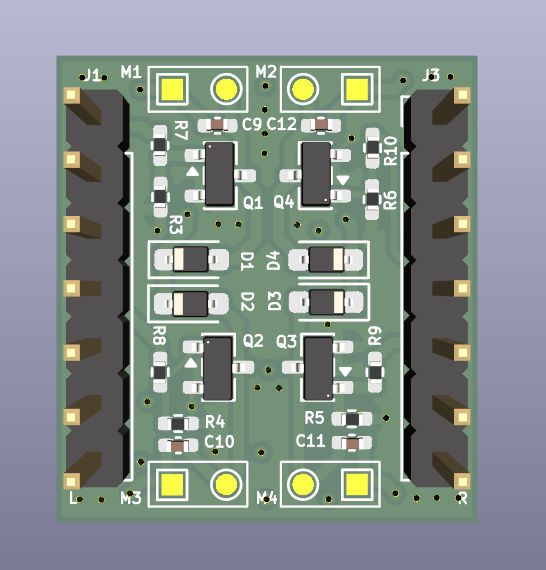
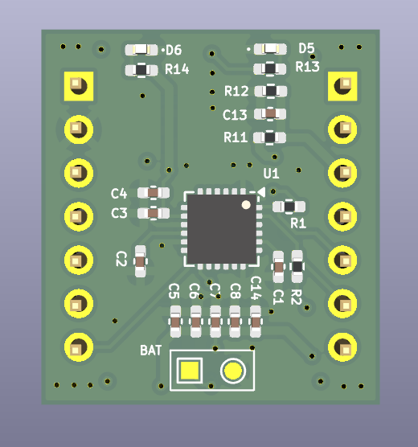

# ESC-ESP32C3

A small brushed-motor ESC and flight-controller board for a drone built around a Seeed Studio XIAO ESP32-C3. The XIAO is the flight controller. An MPU6050 on the board supplies the accelerometer and gyroscope. Four 720 coreless motors are switched by AO3400A MOSFETs. The drone is flown from the ESP-Drone phone app over the XIAO's Wi-Fi.

## Board

Motor side. The XIAO plugs into headers J1 and J3. M1–M4 are the motor pads.

Sensor side. U1 is the MPU6050. The battery connects at the BAT pads.

## Parts

| Part | Role |
| --- | --- |
| Seeed Studio XIAO ESP32-C3 | Flight controller. Plugs into J1 and J3. |
| MPU6050 (U1) | 6-axis gyro and accelerometer, I2C address 0x68 (AD0 held low). |
| 720 coreless motor × 4 | Brushed motors on M1, M2, M3, and M4. |
| AO3400A × 4 | Low-side MOSFET for each motor. |
| Schottky diode × 4 | Flyback diode across each motor (SOD-323). |
| ESP-Drone app | Phone app used to control the drone. |

## XIAO pins

Seat the XIAO with the USB end toward the 5V / D0 end of the headers (J3 pin 1 is 5V, J1 pin 1 is D0).

| XIAO pin | GPIO | Function |
| --- | --- | --- |
| D0 | GPIO2 | Motor 1 gate (MOT1) |
| D3 | GPIO5 | Motor 2 gate (MOT2) |
| D9 | GPIO9 | Motor 3 gate (MOT3) |
| D10 | GPIO10 | Motor 4 gate (MOT4) |
| D4 | GPIO6 | MPU6050 SDA |
| D5 | GPIO7 | MPU6050 SCL |
| D7 | GPIO20 | MPU6050 interrupt |
| D2 | GPIO4 | Battery voltage sense |
| 3V3 | — | Sensor and gate pull-ups |
| GND | — | Common ground |

D9 is a boot strap pin. Its gate pull-down must leave the pin high enough at reset for the XIAO to start normally. Holding D9 low during reset puts the module into download mode.

D6 (GPIO21) is left free. It is the serial transmit pin and toggles while the chip boots.

## Assembly

1. Solder the MPU6050, MOSFETs, diodes, and passives.
2. Plug the XIAO ESP32-C3 into J1 and J3. Do not reverse it: 5V and D0 share one end of the module.
3. Solder one 720 coreless motor to each of M1–M4. The motor positive lead goes to the BAT+ pad of that pair.
4. Connect the flight battery at the BAT pads.
5. Power the XIAO, join its Wi-Fi from the ESP-Drone app, and arm the motors only after the propellers are clear.

## Design files

Open `ESC.kicad_pro` in KiCad 10.

| Path | Contents |
| --- | --- |
| `ESC.kicad_sch` | Schematic |
| `ESC.kicad_pcb` | PCB layout |
| `libraries/` | XIAO ESP32-C3 and MPU6050 symbols and footprints |
| `GERBER/` | Fabrication Gerbers and drill files |
| `ESC-BOM.csv` | Bill of materials |
| `ESC-all-pos.csv` | Pick-and-place positions |
| `ESC-ESP32.step` | 3D model of the board |
